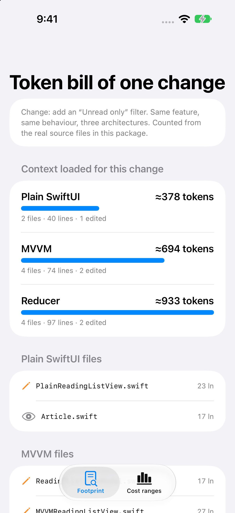
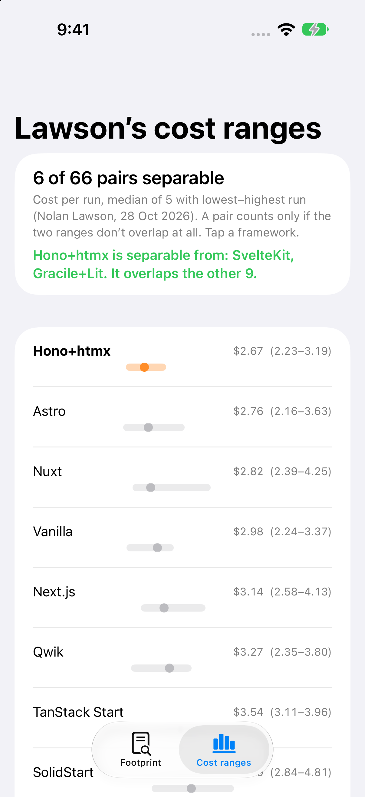

# ArchitectureTokenBill

**What does an iOS architecture cost when a coding agent writes most of the code?** This repo measures one part of that bill for real and gives a team a small harness for the rest.

Article: (added after publish)

<p align="center"> </p>

## What's in it

**1. The same feature in three architectures** (`Sources/ArchitectureTokenBill/Features/`): a reading list that loads seed data, toggles read state and saves after every toggle.

| Architecture | Files an agent loads to add an "Unread only" filter | Non-blank lines | ≈ Tokens |
|---|---|---:|---:|
| Plain SwiftUI | `PlainReadingListView` (edit), `Article` | 40 | 378 |
| MVVM | `ReadingListViewModel`, `MVVMReadingListView` (edit), `ReadingListService`, `Article` | 74 | 694 |
| Reducer | `ReadingListFeature`, `ReducerReadingListView` (edit), `Store`, `Article` | 97 | 933 |

The numbers live in `MeasuredFiles.swift`, and `FootprintTests` re-measures the real source files on every test run, so they can't drift from the code. Tokens are characters ÷ 4, a rule of thumb, not a tokenizer. This is context loaded once; a real session re-reads files and build output on top. The plain version is cheapest to read and also the only one whose filter logic has no unit-test seam.

**2. A benchmark harness** (`Sources/ArchitectureTokenBill/Benchmark/`) for when your team reruns the experiment on its own feature:

```swift
let summaries = ArchitectureSummary.summarize(runs)   // median + min–max per architecture
summaries[0].costPerPassingRun                          // all spend ÷ runs that passed conformance

let pairs = RangeComparison.separablePairs(items)       // only pairs whose ranges don't overlap
```

**3. Nolan Lawson's published cost data** (`LawsonBenchmark.cost`): median, lowest and highest run for 12 frameworks, copied from [The AI cost of JavaScript frameworks](https://nolanlawson.com/2026/10/28/the-ai-cost-of-javascript-frameworks/) (28 Oct 2026). A test pins the result the article relies on: **6 of 66 pairs have non-overlapping cost ranges**. Min–max overlap is a deliberately crude, conservative check, not a significance test.

## How to run it

```bash
git clone https://github.com/rajatslakhina/architecture-token-bill-article-demo.git
cd architecture-token-bill-article-demo
open Demo.xcodeproj   # pick an iPhone Simulator, then Build & Run (⌘R)
```

No other setup: the app uses the library through a local Swift package reference in the same repo. Library only: `swift build && swift test`. Screenshots: `./Scripts/simulator-screenshots.sh` builds, installs, launches each screen, checks the app is still running and saves PNGs to `Demo/Screenshots/`.

## Verification status

- `swift build -Xswiftc -warnings-as-errors`: clean. `swift test`: 20/20 passing (Xcode 26 toolchain on macOS).
- Simulator: built with `xcodebuild` and run on a fresh iPhone 18 Pro (iOS 27.2) simulator; four launches through launch arguments, each followed by a check that the process is still alive; the screenshots in `Demo/Screenshots/` come from those runs.
- CI (`.github/workflows/ci.yml`) repeats both on GitHub's macOS runners.

## Sources

- Nolan Lawson, [The AI cost of JavaScript frameworks](https://nolanlawson.com/2026/10/28/the-ai-cost-of-javascript-frameworks/), 28 Oct 2026 ([benchmark repo](https://github.com/nolanlawson/agent-framework-benchmark), [HN discussion](https://news.ycombinator.com/item?id=50323088)).

MIT licensed.
